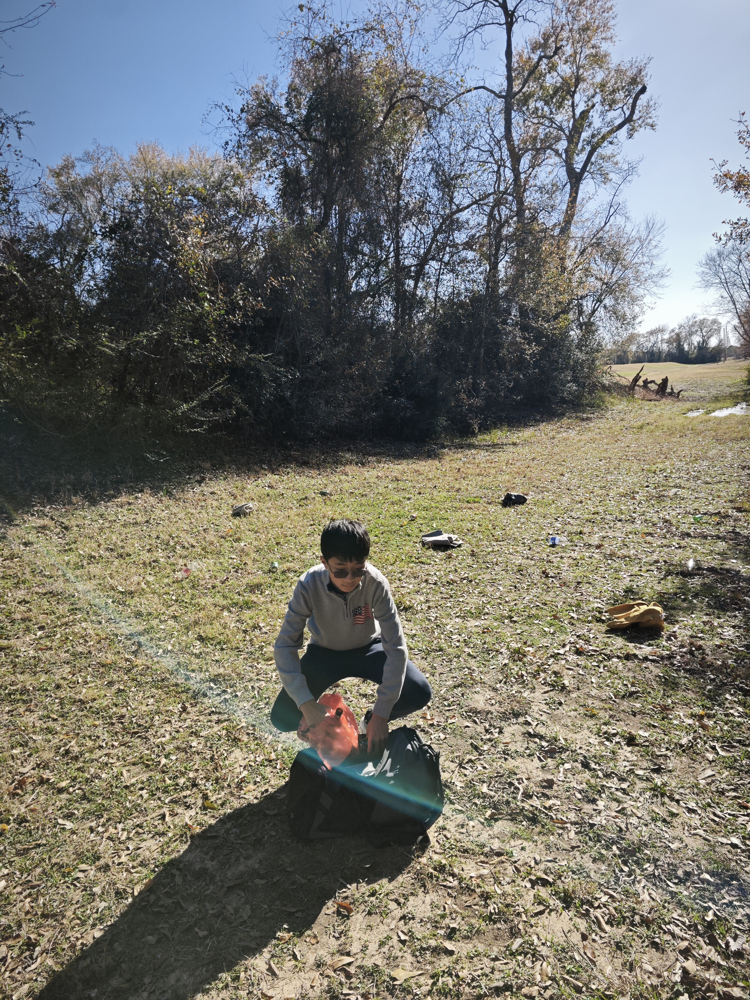
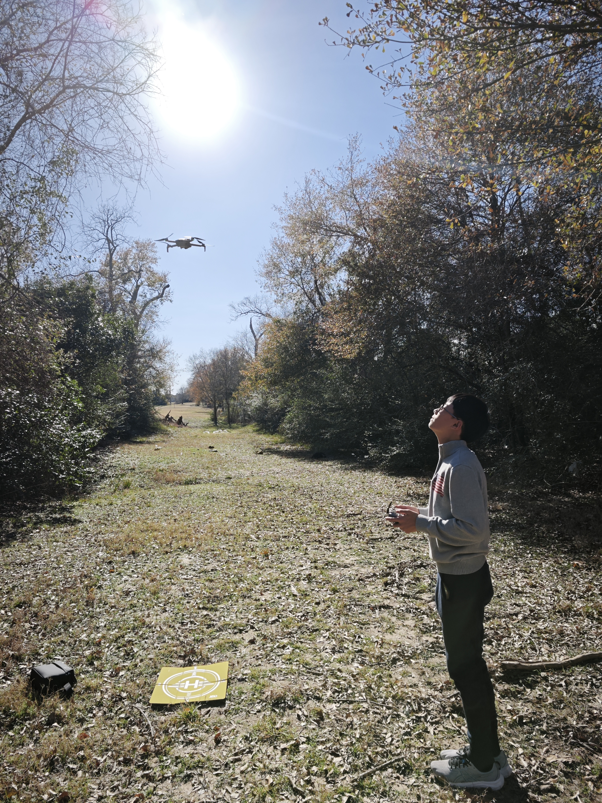
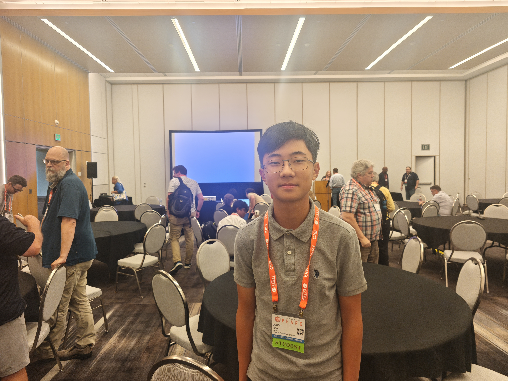
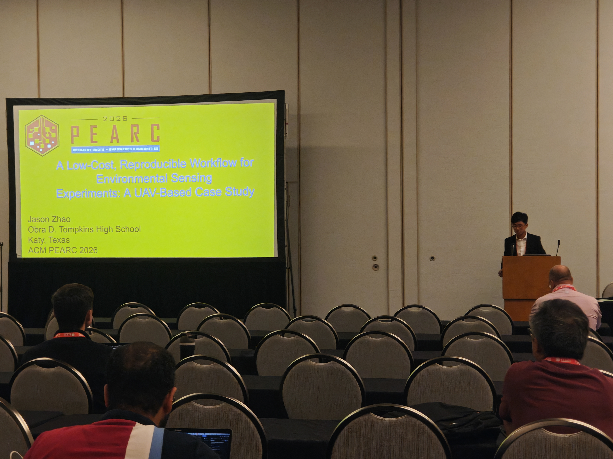

# Jason Zhao

I'm a high school student at Obra D. Tompkins High School in Katy, Texas (Class of 2028), interested in electrical and computer engineering, computer vision, and cooperative robotics.

My independent research focuses on using UAVs and ground robots for environmental monitoring and litter collection. I enjoy connecting software, sensors, and hardware to build and test systems in real outdoor environments.

## Research Interests

- UAV–UGV cooperative robotics
- Computer vision and object detection
- Robot localization and visual correction
- Embedded systems and sensor integration
- Environmental sensing and monitoring

## Research Projects

### GA-Sweep: UAV–UGV Cooperative Litter Collection
*Independent Research and Engineering Project | July 2026–Present*

Developing a robotic system for litter collection in outdoor green spaces. The system combines UAV-based target mapping with close-range visual correction by a ground robot.

- Completed UAV mapping benchmarks across three sites and initial ground-robot tests.
- Developing AprilTag-guided docking and a cooperative funnel-and-gate collection mechanism.
- Integrating computer vision, ground-robot motion control, and onboard hardware.

### UAV-Based Litter Detection in Forest Environments
*Independent Research Project | Published in ACM COMPASS 2026*

Investigated how litter types and environmental conditions affect UAV-based object detection.

- Conducted a controlled field experiment using 375 annotated aerial images and YOLOv11n.
- Applied ANOVA and Tukey HSD tests to analyze detection performance.
- Developed recommendations for UAV deployment and training-data collection.

**Public dataset:** [UAV Litter Detection Dataset](https://github.com/jasonzhao2020jz/uav-litter-detection)

## Publications & Presentations

- **Environmental Constraints in UAV-Based Litter Detection: Deployment Insights from a Forest Park Case Study.**  
  Proceedings of the 2026 ACM SIGCAS/SIGCHI Conference on Computing and Sustainable Societies (COMPASS ’26), pp. 83–88.  
  [Paper](https://doi.org/10.1145/3811242.3819998)

- **A Low-Cost, Reproducible Workflow for Environmental Sensing Experiments: A UAV-Based Case Study.**  
  Oral presentation at the ACM Conference on Practice and Experience in Advanced Research Computing (PEARC26), 2026.  
  Received a PEARC26 Bridge Grant.

- **Toward Progressive UAV-UGV Localization: Benchmarking UAV Cross-Image Variation.**  
  Manuscript under review at the 10th IEEE International Conference on Robotic Computing & Communication (RoboticCC 2027).

 
 
    
   
 

  **Presenting my research at ACM PEARC26.**  
  
## Technical Skills

- **Programming & Tools:** Python, Java, Linux, Google Colab
- **Computer Vision:** OpenCV, YOLO object detection, Roboflow, image annotation, model training and evaluation
- **Robotics:** UAV waypoint planning, ground-robot motion control, UAV–UGV system integration
- **Hardware & Embedded Systems:** Raspberry Pi, camera integration, IMU-based heading estimation and calibration, servo and DC motor control, UART serial communication, Pololu servo controllers
- **Data Analysis:** Experimental design, ANOVA, Tukey HSD, data visualization

## Beyond Engineering

I play flute in my school's wind ensemble and marching band. As a team leader with Music of Harmony, I help organize volunteer performances at senior centers and nursing homes, as well as benefit concerts supporting charitable causes.

I also enjoy piano, tennis, and basketball.

**Email: zhao.jz.jason@gmail.com**
